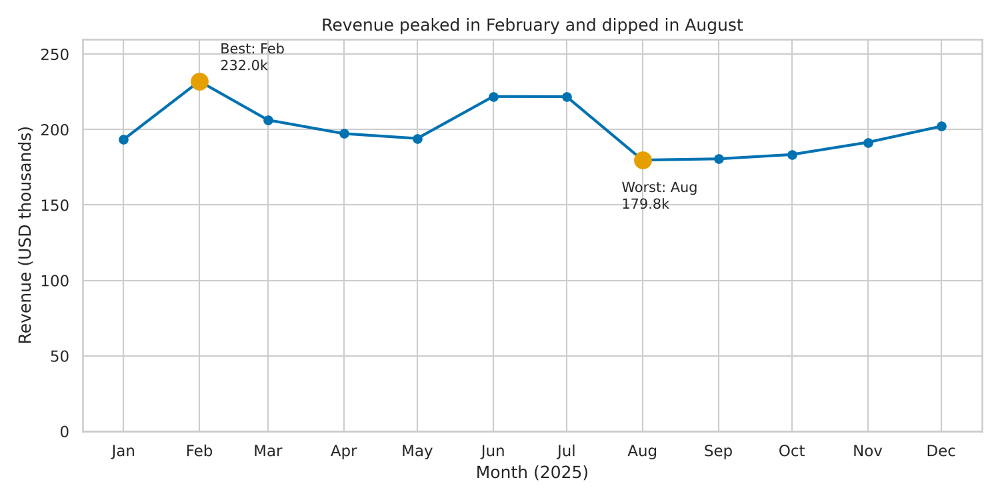
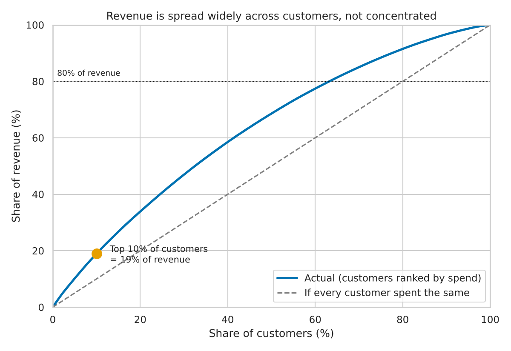

# Customer Churn / Sales Trend Analysis

**Project 03 | Data Science & AI | InternCircle**

End-to-end analysis of an e-commerce sales dataset to find revenue trends, the best product categories and the most valuable customers, with recommendations for a business reader.

> **Data used: generated (simulated) data.** 2,000 orders, 300 customers, 1 Jan to 31 Dec 2025, created with a fixed random seed. No real customer data is used.

## Business questions
1. Which months and categories earn the most?
2. Who are the best customers, and does the 80/20 rule hold?
3. Which customers may be leaving?
4. What should the business do next?

## What is in the analysis
- Date feature engineering (month, quarter, weekday, half-year)
- Monthly revenue trend and month-over-month growth with `pct_change()`
- Category comparison with `groupby` and a month-by-category pivot table
- Top-customer (Pareto) analysis
- Simple churn check (no order in the last 90 days)
- Three recommendations backed by numbers

## Key findings
- H2 revenue was about 6.9% lower than H1; February was the best month and August the worst.
- Fashion and Electronics bring 65.6% of revenue.
- The 80/20 rule does not hold: the top 10% of customers bring 18.9% of revenue.
- 52 customers (17.3%) have not ordered in 90 days.




## Files
- `Sales_Trend_Analysis.ipynb`: full notebook
- `Sales_Trend_Analysis.html`: notebook as a web page
- `Business_Brief.md`: one-page business brief
- PNG files: saved charts

## Run it yourself
```
pip install jupyter pandas numpy matplotlib seaborn
jupyter notebook Sales_Trend_Analysis.ipynb
```
Or upload the notebook to Google Colab and choose Runtime > Run all.

## Limitations
Simulated data, one year only, and an assumed 90-day churn rule. Recommendations are suggestions to test, not guaranteed results.

**Author:** Sankari

